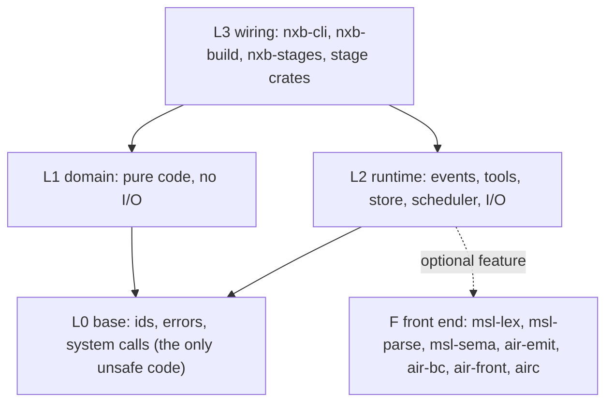
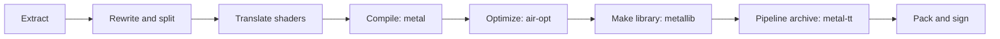

# nxbuild

nxbuild is build tooling written in Rust. It changes Switch game packages into Apple builds. It extracts game data, rewrites and
compiles shaders, makes pipeline archives, and packs and signs the app. Use it only with games that you own.
No game data, keys or shaders are in this repository.

The tools replace a set of reference build scripts (written in Python). The reference scripts are the oracle.
A Rust stage is correct when its output files are byte-identical to the output of the reference scripts.
One part is different: the own shader front end. It is on only for shaders on an allow list, where its output is byte-identical. All other shaders use Apple's compiler. A switch turns the front end off.

## Status

Version 0.2.0 is the third public release. It is early software. Read this section before you use it.

- Mac only. The tools run on macOS on Apple silicon. Other systems are not supported.
- The tools need Apple tools (`metal`, `metallib`, `air-opt`, `metal-tt`, `codesign`, `xcrun`) from your own Xcode.
- A full build is not yet one command. The button-icon font is not ported. `nxb build` takes it from a work folder of the reference build.
  The Mac host, the companion app, the app settings file and the app icon are ported in 0.2.0. `nxb build` end to end with these
  stages was not run on a real title. Each stage was compared alone.
- The code rewrite step (`patch_nso.py` in the reference scripts) is not ported.
- The shader step for iOS is not part of the verified path. Only a sample was compared.
- The reference scripts remain the fallback. If a stage fails or does not support an input, run the reference script for that stage.
  The signer returns exit code 3 for unsupported input. The caller then runs `codesign`.

### What is byte-identical to the reference scripts

All results are **measured** on one reference title, unless a line says **estimate**. The extract step was also compared on two
more titles.

| stage | compared on | result |
|---|---|---|
| Extract and split | reference title, base and update | both `RomFS.img`, ExeFS, 12 package files and all tables are byte-identical |
| Extract, `.nup` | one real Switch 2 package (standalone update) and synthetic containers | the RomFS image digest and the ExeFS and icon files are identical to the reference script. Not checked on real data: base game with update and DLC, and the control data |
| Extract, XCI, merged packages (`--app`), dump folders | synthetic fixtures only | byte-identical to the reference extractors. No real sample was available |
| Extract, NSZ | one real file and synthetic fixtures | the decoded NCA is identical to the output of the reference decompressor. The NCZ block mode was not checked on real data |
| App icon, companion app | one title | byte-identical |
| App settings file | 142 profiles, 425 outputs | byte-identical. One multi-program header is not ported |
| Mac host | one title | reuse key and decoder inputs are identical. The binary is not byte-identical, also not between two runs of the reference script |
| Extract | two more titles (one with an update, `--updates-only`) | `RomFS.img`, ExeFS, control data and icon are byte-identical |
| Shader step, Mac | one full run | 74,421 of 74,422 files are byte-identical. The listing `_b_cas.txt` differs by design |
| Shader step, iOS | 787 sample shaders | 2,889 of 2,889 iOS files are byte-identical |
| App stage and signer | tested bundles | app tree, `Info.plist` and `CodeResources` are byte-identical. The signer matches `codesign` |
| Pipeline archive planning | 18,301 pairs | the plan files are byte-identical. `metal-tt` output is not deterministic, so archives are compared by content |
| IPA writer | a 59-entry sample and a bundle with a 300 MB file | byte-identical. A full game IPA was not built |
| Own front end | 23,785 inputs | 23,752 lower and validate. 8,533 final libraries are byte-identical to Apple's |

### Timings

The reference machine is an Apple M2 Max (8 performance cores, 4 efficiency cores). Other jobs used the CPU in all runs.
The numbers are therefore a little worse than on an idle machine. Source: `docs/benchmarks.md`.

| step | reference scripts | nxbuild | speed-up | label |
|---|---|---|---|---|
| Extract and split | 210 s | 10.5 to 15.5 s | 13 to 20 times | measured |
| Shaders, cold, Apple front end | 799 s | 650 s | 1.2 times | measured |
| Shaders, cold, own front end (identical output only) | 799 s | 586 s | 1.4 times | measured |
| Shaders, cold, own front end (validated output) | 799 s | 416 s | 1.9 times | measured |
| Pipeline archive | 257 s | 273 s | 0.94 times (slower) | measured |
| Mac app stage, fresh | 129 s | 23 s | 5.6 times | measured |
| `nxb build`, shaders given | about 623 s | 317 s | 2.0 times | measured |
| Full build in sequence | 1,422 s | about 960 s | 1.5 times | estimate |

The estimate is the sum of the measured stages. It was not run as one process. The archive step is slower because `metal-tt`
limits it. The own front end is not byte-identical in the validated mode.

### Known limits

- Not ported: code rewrite, button-icon font, header of multi-program profiles, zstd dictionaries, geometry and mesh shaders.
- Not done: Windows and Linux. The process runner and the locks refuse to run there.
- Two processes can write the same store key at the same time. The last writer wins. The files stay valid.
- Parsers read untrusted files. Read [SECURITY.md](SECURITY.md) and [docs/security.md](docs/security.md) for the limits.

## Install from a release

1. Download the ZIP file and the `SHA256SUMS` file from the release page.
2. Check the file: `shasum -a 256 -c SHA256SUMS`.
3. Unpack the ZIP file. The binaries have an ad-hoc signature.
4. If macOS blocks a binary, remove the quarantine flag: `xattr -d com.apple.quarantine <file>`.

## Build from source

You need Rust 1.99 or newer and Xcode command line tools. The workspace has no external crates.

```sh
cargo build --release      # output in ./target/release
tools/check.sh             # format, lints, tests, documentation, layer and size checks
```

Set `CARGO_BUILD_JOBS` to limit parallel compiler processes. Set `CARGO_TARGET_DIR` to move the output.

## Binaries

Every binary prints its usage when you run it without arguments.

| binary | purpose |
|---|---|
| `nxb` | the whole build. `nxb build --platform mac-app` runs all ported stages. `--dry-run` prints the stage graph and the cache keys |
| `nxb-extract` | NSP, XCI, NSZ, XCZ, Switch 2 package (`.nup`, no keys needed) or dump folder (`--dump`) to RomFS images, ExeFS, control data and icon |
| `nxb-split` | shader split of extracted images into package records and tables |
| `shaderbuild` | the shader step: `build`, `recompile`, `guards`, `help`, `version` |
| `nxb-pso` | plan and merge of the pipeline archive. Needs `metal-tt` and `metal-pack` |
| `nxb-macapp` | the Mac app stage |
| `nxb-ipa` | IPA writer |
| `nxb-pack` | ad-hoc signer for bundles and Mach-O files |
| `airc` | the own MSL to AIR front end: `emit`, `bc`, `build`, `check`, `rank` |

### Example

```sh
nxb-extract --keys <prod.keys> --base <base.nsp> --out <dir> --update <update.nsp> <dir-v2>
nxb build --dry-run <arguments>     # print the stage graph first
```

### Environment variables

The tools read no fixed private path. Inputs come from arguments or from these variables.

| variable | used by | meaning |
|---|---|---|
| `NXB_TEST_TMP` | tests | scratch folder for store and I/O tests |
| `DEVELOPER_DIR`, `SDKROOT` | `nxb-tool` | location of the Apple tools. They are passed to child tools |
| `NXB_AIRC` | `tools/front` | the `airc` binary. Default is `target/release/airc` |
| `NXB_PROTO`, `NXB_REF`, `NXB_CORPUS`, `NXB_SPECS`, `NXB_CAS` | `tools/front`, `tools/gpudiff` | inputs that you provide. See `tools/README.md` |
| `NXB_PARITY_*` | parity tests | game files for the comparison tests. Without them the tests skip |
| `NXB_ORACLE_EXACT` | signer tests | set to `1` to compare bytes with the `codesign` of the host. Without it, the tests check that `codesign --verify` accepts our output. Set it on the Mac where the signer was proven |
| `NXB_OWN_FRONT` | `shaderbuild` | set to `0` to switch off the own front end |

## Architecture

The workspace has four layers and one separate layer for the own front end. Dependencies point down only.
The command `cargo run -p xtask -- layers` enforces this.



The build of one game has these steps. Apple tools do the steps in grey.



The index of the documents is in [docs/README.md](docs/README.md).

## Parity tests

Tests that need game files are marked `#[ignore]` or skip themselves. When a variable is not set, the test prints `skipped` and passes.

```sh
NXB_PARITY_BASE=<base.nsp> NXB_PARITY_UPDATE=<update.nsp> NXB_PARITY_KEYS=<prod.keys> \
NXB_PARITY_GAME=<profile game.tsv> NXB_PARITY_REF=<work folder of a reference build> NXB_TEST_TMP=<scratch> \
  cargo test -p nxb-extract --release --test parity_real_data -- --ignored
```

Keys and game files stay on your machine.

## Contributing and security

Read [CONTRIBUTING.md](CONTRIBUTING.md) before you open a pull request. To report a security problem, read [SECURITY.md](SECURITY.md).

## License

MIT. See [LICENSE](LICENSE). Notes about formats and external tools are in [THIRD_PARTY.md](THIRD_PARTY.md).
