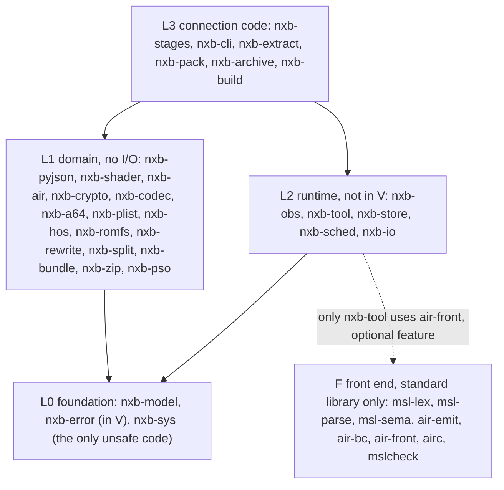
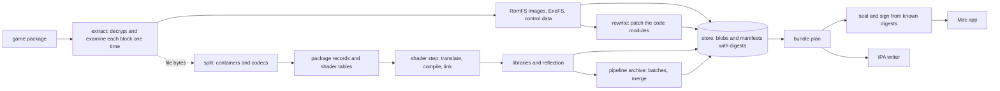

# Architecture overview

This document gives the structure of the workspace: the layers, the crates and the data flow between the stages.
For the decisions behind this structure, refer to [decisions.md](decisions.md).

## Workspace

- The repository is one Cargo workspace. All crates are in `crates/`. The developer tools are in `xtask/`.
- Each crate has the name `nxb-<concern>`. The front-end crates of layer F keep their names (`msl-*`, `air-*`, `airc`, `mslcheck`).
- `nxb-cli` makes two binaries from the same code: `nxb` (the full build) and `shaderbuild` (the shader step).
- The workspace uses the standard library only. At this time, it has no external crates.

## Layers

A crate can use only crates of a lower layer, plus the sideways edges in the table below. The command
`cargo run -p xtask -- layers` makes sure that the crate graph obeys these rules. It reads the layer from
`[package.metadata.nxb]` in each `Cargo.toml`.

The rules:

1. L0 holds the identifiers, the digests, the error classes and the system calls.
2. L1 does no I/O. Its crates are pure functions over bytes and text that return `Result`. L1 can call `nxb-sys` only for pure calculations.
3. L2 knows no shaders, no Switch formats and no app bundles. It runs tasks, keeps blobs, starts child processes and writes events.
4. L2 does not make output bytes of the shader step. The type `OutputFile` has a private constructor in the shader domain crates.
5. Only `nxb-sys` contains `unsafe` code. All other crates have `#![forbid(unsafe_code)]`.
6. L3 connects the stages. One stage module has a maximum of 400 lines.
7. The development crates (`nxb-testkit`, `xtask`) are dev-dependencies only.
8. Layer F uses no `nxb-*` crate. Only `nxb-tool` can use a crate of layer F, and only `air-front` behind the cargo feature `air-front`.

### Sideways edges

| from | to | cause |
|---|---|---|
| nxb-model | nxb-sys | ARMv8 SHA-256 instructions. The digests do not change, thus V does not change (W17). |
| nxb-air | nxb-shader | the MSL lexer, parser and syntax tree |
| nxb-shader | nxb-pyjson | the JSON files of the shader step |
| nxb-hos | nxb-romfs, nxb-crypto, nxb-codec | the NCA data section is a RomFS, AES, NCZ blocks |
| nxb-romfs | nxb-crypto | the `romfs.id` digests |
| nxb-rewrite | nxb-a64, nxb-codec | the AArch64 decoder, LZ4 segments of NSO files |
| nxb-split | nxb-codec, nxb-romfs | decompression, the walk through the image |
| nxb-bundle | nxb-plist | `Info.plist` |
| nxb-zip | nxb-codec | deflate |
| nxb-pso | nxb-pyjson | tables and stamps |
| nxb-cli, nxb-build | nxb-extract, nxb-pack, nxb-archive | the L3 stage crates (W19) |
| nxb-cli | nxb-build | the `nxb build` orchestrator (W19) |
| nxb-build | nxb-stages | the shader step in the build graph (W19) |

## Crates

"V" means that the sources of the crate are part of the chain version. A change in such a crate changes V.
"impl" means that the crate has a full implementation. "skel" means that the crate compiles, but has stubs with documentation only.

| crate | layer | V | state | function |
|---|---|---|---|---|
| nxb-model | L0 | yes | impl | identifiers (`ShaderKey`, `TitleId`, `Target`, `StageId`), `Digest`, own SHA-256, `ContentKey`, `HashingWriter` |
| nxb-error | L0 | yes | impl | error classes, reason strings, `BuildError`, `EnvError` with errno classes |
| nxb-sys | L0 | no | impl | process groups, memory size, core counts, locks, clonefile, zlib, AES, SHA instructions |
| nxb-pyjson | L1 | yes | impl | a JSON writer that gives the same bytes as Python `json.dumps`. Measured: byte-identical on 16,269 JSON files of the reference title. |
| nxb-shader | L1 | yes | impl | MSL lexer, parser, passes, NVN decode, reflection, variants, guards, keys, `OutputFile` |
| nxb-air | L1 | yes | skel | the in-process front end (planned, W18) |
| nxb-crypto, nxb-codec, nxb-a64, nxb-plist, nxb-hos, nxb-romfs, nxb-rewrite, nxb-bundle, nxb-zip, nxb-pso | L1 | no | skel | pure domain logic. Some of it is in the stage crates at this time. |
| nxb-split | L1 | no | impl | containers, shader keys, package records and tables. It supports the container formats of the three tested titles. Other formats stop with a named `Unsupported` error. |
| nxb-obs | L2 | no | impl | NDJSON events and sinks |
| nxb-tool | L2 | no | impl | `Tool` trait, `Invocation`, environment allow list, watchdog, circuit breaker, `Translator` trait, `FrontEnd` trait |
| nxb-store | L2 | no | impl | content-addressed blobs, keyed entries with manifests, quarantine |
| nxb-sched | L2 | no | impl | work-stealing executor with token and memory budgets, single-flight |
| nxb-io | L2 | no | impl | parallel reader, ordered writer, tree clone, digest index |
| nxb-stages | L3 | no | impl | one module for each stage, the shader step |
| nxb-cli | L3 | no | impl | the binaries `nxb` and `shaderbuild` |
| nxb-extract | L3 | no | impl | extract and fused split for NSP packages |
| nxb-pack | L3 | no | impl | the Mac app stage, the ad-hoc signer, the IPA writer |
| nxb-archive | L3 | no | impl | the pipeline archive: plan, batches, merge |
| nxb-build | L3 | no | impl | the orchestrator `nxb build` |
| nxb-testkit, xtask | dev | no | impl | seeded generators, the parity differ, the layer and size checks |
| msl-lex, msl-parse, msl-sema, air-emit, air-bc, air-front, airc, mslcheck | F | no | impl | the own front end. Refer to [frontend.md](frontend.md). |

## Data flow of the stages

The arrows show data only. There are no barriers between the stages. The split starts on the first file that the
extract decrypts. The first archive batch starts when its libraries are in the store. Only the seal waits for all data.

## Store format and API stability

Each store key has a stage version and the content hash of the stage inputs, but not the chain version V (W21, [early-cutoff.md](early-cutoff.md)).

The store format 1 has these folders: `blobs/<2 hex>/<64 hex>`, `entries/<2 hex>/<64 hex>.manifest`, `quarantine/`, `tmp/`.
A manifest is text with sorted names and a checksum line.

The API of the shared crates (`nxb-model`, `nxb-error`, `nxb-tool`, `nxb-store`, `nxb-sched`, `nxb-obs`) does not change in one primary version of the workspace. A change that breaks the API is a separate
commit with a note in `CHANGELOG.md`.
