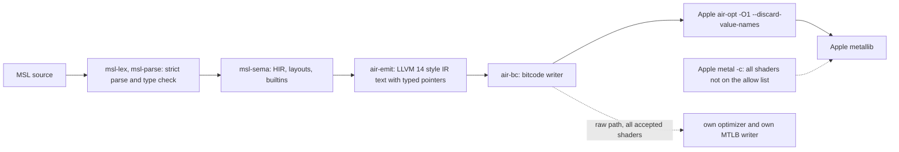

# Own shader front end

The own front end changes the machine-generated MSL of the engine into AIR. Apple's back half then makes the library.
The own front end has two paths. The identical path compiles only the shaders on the allow list. The allow list is the shipped verdict file.
It contains only shaders with the verdict `own-identical`. The raw path (new as the default in 0.4.0) compiles every Mac shader that the front end accepts.
**The raw path is not byte-identical to Apple's output.** The Apple front end compiles all other shaders.
To use the Apple front end for all shaders, set `NXB_OWN_FRONT=0`. To turn off only the raw path, set `NXB_OWN_RAW=0`.

All numbers come from measurements on the reference machine (macOS 27.2, Metal toolchain 32023.922), unless they have the label "estimate".
The corpus has 23,785 compile inputs of the reference title. It stays on the local machine. Other programs used the CPU during some measurements.

## Pipeline

| crate | function |
|---|---|
| `msl-lex`, `msl-parse` | tokenizer, strict parser and type checker. On the corpus, tokens and accept or reject decisions agree with the Python prototype. |
| `msl-sema` | types and MSL layouts, HIR, scopes, explicit conversions, builtin overloads |
| `air-emit` | LLVM text, metadata, function bodies, entry ABI and argument metadata, argument buffers, `air.*` intrinsics |
| `air-bc` | a parser for the IR text that `air-emit` writes, and a bitcode writer in the LLVM 14 format. Other input is an error, and the caller uses the text path. |
| `air-front` | the in-process API. `compile(msl, target)` gives bitcode and the back-half arguments. `id()` gives a version string for cache keys. |
| `airc` | the command-line driver (the command `nxb airc`): `emit`, `bc`, `build`, `check`, `rank`, `deny`, `repack`, `time`, `raw`, `rawcmp`, `rawcheck` |
| `mslcheck` | an accept or reject checker for engine MSL files |

All crates use only the standard library and forbid `unsafe` code. `nxb shaders` reads the verdict file with `--own-front <verdict file>`.

## Results

| measure | macOS | iOS |
|---|---|---|
| inputs that compile and pass `air-validate` | 23,752 of 23,785 (99.86 %) | 23,752 of 23,785 |
| libraries byte-identical to Apple output | 8,533 (35.9 %) | 8,537 (35.9 %) |
| bitcode path (one `air-opt` call) | all 23,752, no text fallback | all 23,752 |
| GPU output of different libraries (298 shaders) | 285 the same, 4 in 4 ULP, 9 with a nondeterministic reference | the Mac GPU cannot run iOS AIR |
| GPU machine code of different libraries (`metal-tt`) | 17 of 20 pairs the same | 27 of 30 pairs the same |
| CPU time for each input (500 inputs, 6 processes) | 96 ms (Apple: 183 ms) | 105 ms at a higher load |

The 33 inputs that do not compile are parser rejects: threadgroup address-space values, some templates, `<metal_atomic>`.

The own front end does not support these constructs at this time. They go to the Apple front end: texture `write` other than 2D, `read` and `gather`
other than 2D, `get_width` other than 2D, half builtins, matrices, `simd_*`, barriers, sample gradients, arrays of
resources in argument buffers.

## Verdicts

`nxb airc check --opt --ref-store DIR` writes one verdict for each input and each target convention:

1. `own-identical`: the library bytes are equal to Apple's bytes. The own path is safe by proof. A GPU test is not necessary.
2. `own-validated`: the library passes `air-validate`, but the bytes are different. By default the Apple front end compiles it.
   The machine code is the same in most samples, and the GPU output is in 4 ULP. But no proof applies to each shader.
   A family can go to the own path subsequently with a data change, after a clean GPU sample.
3. `apple`: the input does not compile. The Apple front end compiles it.

`nxb airc deny --results R.jsonl` writes the deny list. `nxb airc deny --allow` writes the allow list.
Mac: 8,533 permitted, 15,252 denied. iOS: 8,537 permitted, 15,248 denied.

The allow list is the default. With a deny list, each shader that is not in the corpus (a new game or a new engine version)
can go through the own path without a check. The allow list prevents this. Make the list again when `air_front::id()` or the Apple toolchain changes.
The identity check compares with the output of that toolchain.

## Speed

On 500 inputs with 6 processes, the own front end with one `air-opt` call used 96 ms CPU for each input. The Apple front end
used 183 ms (measured with load). A test without the optimizer used 83 ms, but it changed the machine code of all shaders.
With bitcode input, one `air-opt` call does two steps and saves approximately 14 % CPU.

In the full shader step, the own front end decreased the wall time by 10 % with the same output and by 36 % with
validated output (refer to [benchmarks.md](benchmarks.md)).

## Partial byte identity

The own IR is equivalent to the IR of clang, but the instruction order is not always the same. The optimizer inlines,
sinks and orders phi nodes by the shape of the IR. Thus a different shape can give a different library, and in rare
cases a difference of 1 to 4 ULP in fast-math code. The remaining classes are call operand order, the position of `fneg`
and `nocapture` on some helper arguments. To close them, the front end must copy the accurate instruction order of clang
in larger helpers. Vertex positions must be accurate to the bit. Thus shaders with different libraries stay on the Apple front end
until the IR agrees.

## Own library writer and own optimizer

The front-end code can parse and write the `MTLB` container (210 of 210 Apple libraries rewritten byte-identical).
But `metallib` also runs its own pass list on each function, and no LLVM pass subset gave Apple's machine code (0 of 15 pairs).
Thus Apple's `air-opt -O1` and `metallib` stay for the default path (decision D17).

## Raw container path

The raw path is not byte-identical to Apple's output. It does not use `air-opt` or `metallib`.

- `air-bc` splits the module into one module for each entry point and prunes the function constants.
- The own optimizer in `air-bc` does `mem2reg`, removal of trivial phi nodes, block-local common subexpression removal and removal of dead code.
  `mem2reg` also removes the loads and stores of a promoted variable in blocks that no path reaches. Such a load reads `undef`.
- `air-front` writes the bitcode and the `MTLB` container itself. The call is `build_raw`. The commands `nxb airc raw`, `rawcmp` and `rawcheck` use it.
- `airc rawcheck` writes one JSON line for each input. A built library has `lib_sha256`. A reject or a failed build has `error` with the reason.
- The raw libraries are larger than Apple's libraries (1.33 times on 40 samples, measured).

**Default since 0.4.0.** The raw path is on for each Mac shader that the front end accepts. Before, it was on only for shaders on a raw allow list.
Each library goes through a check in the process. The library must parse as a metallib and write back to the same bytes. Its functions must have names and valid bitcode wrappers.
If the front end rejects the shader or the check fails, the shader goes to the next tier. The check does not run the shader on a GPU.

The evidence for a raw library is the GPU differential test, not byte identity. The test covered only a part of the corpus:

| result of the GPU test (12 vectors) | shaders |
|---|---|
| candidates tested | 3,625 of 23,752 (about 15 %) |
| same output as Apple's library | 3,375 |
| different output | 220 |
| not deterministic (the reference also) | 29 |
| not built | 1 |

The old raw allow list has 3,365 entries (about 14 % of the corpus). Each entry is a shader that matched in this test and that the front end rebuilds byte for byte.
10 of the matching sources no longer exist on the test machine. The list is not in this repository. `NXB_OWN_RAW=list` uses it when you have the file.
**Nobody ran a GPU test for the other shaders.** In the tested sample, 220 of 3,625 differed. The sample was not random.
Thus the rate for the other shaders is not known, and some of them can give a different output than Apple's library.
A smoke test of the harness on 8 shaders gave 7 equal and 1 different (the largest error was 166 ulp). This is not a sample.
If you see a visual difference, set `NXB_OWN_RAW=0` and build again. The cache key has the field `own-raw@`, thus the libraries of the two modes do not mix.

Speed (measured, 20 large vertex shaders, loaded machine): the raw path used a median of 39 ms for the emit, 35 ms for the text IR to bitcode step,
18 ms for the split and the writer, and 40 ms for the optimizer. This is more than the earlier estimate of 15 to 20 ms for each shader.
A full-corpus run at 6 threads gave a median of 33 ms and a mean of 71 ms for each input (measured).
The next cheap decrease is to write the bitcode without the text IR (about 35 ms, estimate).
[shader-step.md](shader-step.md) describes the tier in the shader step and the measured gain.

Not done: the raw path for iOS (there is no GPU test for iOS libraries), a GPU test for the other 85 % of the corpus,
and a GPU test of the side-unit cut of a raw library on its own.

## Tests

- Unit and case tests: `crates/msl-parse/tests`, `crates/air-emit/tests`.
- GPU differential test of own libraries against Apple libraries: refer to [gpu-differential-testing.md](gpu-differential-testing.md).
- `cargo test -p air-front -- --include-ignored` runs the tests that use Apple's tools.
- The scripts in `tools/front` read environment variables and do not use a default path: `NXB_AIRC` (the `airc` program of the front end workspace),
  `NXB_PROTO` (the Python prototype), `NXB_REF` (reference folder with stored Apple libraries), `NXB_CORPUS`
  (one MSL path on each line), `NXB_SPECS` (prepared GPU test specs).

For the AIR rules, refer to [air-conventions.md](air-conventions.md). For the studies, refer to
[research/frontend-internals.md](research/frontend-internals.md) and [research/reference-corpus.md](research/reference-corpus.md).
