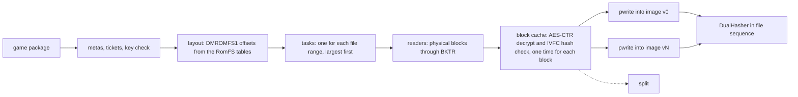

# Pipeline stages

This document gives the stages around the shader step: extract, split, rewrite, pack, sign and the pipeline archive.
Each stage is a pure data change, and the reference build scripts give a correct output for it.
Thus the acceptance rule is byte identity with the reference build scripts.

## Scope

| stage | reference build scripts |
|---|---|
| extract (NSP, XCI, NSZ, NUP, dump to `extract/<ver>/`) | a C# extractor, one process for each version, in series |
| rewrite (patches of the code modules) | Python with Capstone, process pool |
| split (shaders out of the game files) | Python, pool of 8 processes |
| Mac app, pack and sign | Python, `cp -c`, `codesign` |
| IPA and iOS shell | shell, Python, `xcodebuild` |
| pipeline archive | 19 batches of 1,000 bases in series, `metal-tt`, `metal-pack` |

For the timings, refer to [benchmarks.md](benchmarks.md). Not in scope: a replacement of `metal-tt`, `metal-pack`, `xcodebuild` or `clang`, a change of the host file formats
(`DMROMFS1`, package records, `romfs.id`, `prebuilt.tsv`), and network access.

## One hash for each byte

The stage that makes a byte calculates its digest while the byte is in memory. A subsequent stage does not read payload bytes again to hash them.

- A manifest holds for each file: relative path, mode, length, SHA-1, SHA-256 and a stat fingerprint (`dev`, `ino`, size, `mtime_ns`, `ctime_ns`).
- A consumer compares the stat fingerprint with one `fstatat` call. If the fingerprint does not agree, the consumer hashes the file and counts it. This is not an error.
- Only the `files` list of `CodeResources` uses SHA-1. `DualHasher` calculates SHA-1 and SHA-256 in one pass.

The store makes the work folder (`<id>_build/extract/<ver>/`, `shader/cache/b-<V>/`) with one directory clone on APFS, or with a copy on other file systems.

## Extract

- **Layout first.** The image format puts the file bytes in sorted entry sequence without padding, then the index.
  Thus the stage knows the offset of each file before it reads data. Parallel `pwrite` calls give the same bytes as a sequential writer.
- **One pass for all versions.** The base version and the update use mostly the same base blocks. The block cache decrypts
  and examines each block one time and gives it to all tasks that use it.
- **Damaged blocks.** A block that does not agree with the IVFC hash marks its files as damaged. Without `--allow-damaged`,
  the stage lists all damaged files and stops with exit code 3. With `--allow-damaged`, it writes the bytes and sets the damaged flag.
- **Special packages.** Each special case (sparse NCAs, XCI secure partitions, merged NSPs, NUP, dump folders) gets a named test with a synthetic fixture.
- **Exit codes:** 2 incorrect command, 3 damaged, 4 sparse without update, 5 no meta, 6 keys too old.

At this time, the stage supports NSP packages (NCA, IVFC, BKTR, RomFS image, ExeFS, NACP, zstd, LZ4).
It also reads game cards (XCI), compressed packages (NSZ and XCZ), Switch 2 packages (`.nup`) and dump folders.
A `.nup` package needs no keys. Use `nxb extract --nup <game.nup>` or `nxb-extract` with the same arguments.
Use `--dump <folder>` for a dump folder. The output layout is the same as the layout of the reference script for dump folders.
The stage writes `extract/v<version>/` (ExeFS, RomFS image, control data and icon) and `aoc/<index>.img` for each DLC.
It checks each file against its size and its SHA-256, and it stops on a damaged or incomplete package.
Without `--version`, it takes the newest update. When the package has no base game, it uses the update as the whole game.
`--discard-images` makes the digests and does not write the images. `--no-images` writes only the code modules and the control data.

- **XCI.** The stage reads the secure partition of the game card.
- **NSZ and XCZ.** The stage decodes the NCZ block streams and the NCZ solid streams with the own zstd decoder.
  The decoder streams the data and has an output limit. The stage needs no external program.
- **Merged packages.** A package can hold more than one game. `--app <id>` gives the application id in hexadecimal.
  The stage then uses only the contents of that application.

Not ported at this time: zstd dictionaries, the `--html` output of some titles and games with more than one program.

### Tests on real data

- NSP: three titles.
- NUP: one real package (a standalone update). The RomFS image digest, the ExeFS and the icon are identical.
- NSZ: one real file. The digest of the decoded NCA is identical to the digest of the output of the reference decompressor.
  The NCZ block mode was not checked on real data.
- XCI, merged packages (`--app`) and dump folders: only synthetic fixtures. The output is byte-identical to the output of the reference extractors on these fixtures.
  No real sample was available.

## Split

- The split reads file bytes from the block cache of the extract. It examines a file when the extract decrypts the last block of the file.
  When the extract output is in the store, the split reads the image with `ParallelReader`. It reads a file only one time.
- Each container family is a module. `sniff` uses magic bytes, not file names. Nested containers recurse with a depth limit.
- The key of a shader is `sha256(control[:0x880] ‖ code)[:16]`.
- The output sequence is the contract. Rows record the first occurrence. The split sorts the results in the walk sequence
  of the reference build scripts: versions, sorted paths, `main`, NROs, captures. It does not use the completion sequence.
- Decoders that only the game has (for example Oodle) operate through the host, behind a `Tool` adapter.

At this time, the split supports the container formats of the three tested titles (for example SARC, BNSH, BAHS and NSO).
A different format stops the split with a named `Unsupported` error. The reference build scripts read approximately 35 container formats.

## Rewrite

`nxb-rewrite` decodes each AArch64 instruction of each code module with the own decoder `nxb-a64`. It changes `x18`,
`tpidr*`, `svc`, `cntpct_el0`, misaligned `sp`, lock acquires, spin loops, cuts and observation gates, and writes
`.patched.bin` and five TSV tables. At this time, the rewrite stage is a skeleton.

## Host stages around the app

The Mac stages around the app use `make`, `clang`, `swiftc`, `sips` and `iconutil` as external programs.
Each program runs through the `Tool` trait with the exact environment of the reference build script.

| stage | result against the reference build scripts |
|---|---|
| App icon | byte-identical (measured on one title) |
| Companion app | byte-identical (measured on one title). The reuse key file contains the sources, the compiler versions, the SDK and the minimum system version |
| App settings file (`launcher.json`) | 425 of 425 outputs byte-identical for the 142 profiles of the reference engine. The test skips one multi-program profile. Its header is not ported, but its settings are identical |
| Mac host | the reuse key and the decoder inputs are byte-identical. The binary is not byte-identical |

The Mac host binary is not reproducible, also not with the reference script. Two builds with the reference script differ in 2,029 bytes.
The differences are the `LC_UUID` and the debug map in `__LINKEDIT`. Thus the test compares the same key, the same decoder inputs
and the same bytes before `__LINKEDIT` with the UUID set to zero. The reference script reuses a build of the Rust stage and the other way round.

These stages are not ported:

- The button-icon font (`make_ext_font.py`). `nxb build` uses the `font/` folder of the work folder.
- The header of multi-program profiles.

Some conversions approximate Python behavior. The code documents them: the `repr` of non-ASCII characters
(the stage escapes only C1 control characters, the no-break space and the soft hyphen), the whitespace rules of `shlex`,
and the replacement of `DMSH_CHAIN` line by line. The tools do not get `DEVELOPER_DIR`.
When you set it, the `clang --version` text of the reference script can be different.

`nxb build` runs these stages. This complete path (`nxb build` end to end with the new stages) was not run on a real title.
The test compared each stage alone. One title gave a test of the overlap of these stages in version 0.3.0 (refer to the next section).

## Stage overlap in `nxb build`

The module `nxb-build::order` puts the stages of `nxb build` in a graph. A stage runs in one of two ways:

- **In its turn.** The extract, the shader step, the archives and the app stage run one after the other on the main thread.
  They write their `step`, `progress` and `say` events into their own stage.
- **Early.** The Mac host and the app parts start on their own threads when the stages that they depend on are done.
  An early stage writes no event. It gives its summary to the main thread.

The Mac host (`make` and `clang`) starts at the same time as the extract. The app parts are the companion app, the icon
and the settings file. They start when the extract and the host are done, beside the shader step.
The first pipeline archive starts its batches when the libraries that they use are ready.
When the shader step stops, the archive stream gets one worker for each slot instead of 3 workers, if memory permits.

The events do not change. `nxb build` writes `stage` and `stage_end` in the order of the graph, thus the NDJSON stream is the stream of a run
in series. Only the fields `t` and `elapsed` are different. If a stage fails, it reports in its own turn. The stages before it
still run and report. A stage with a failed dependency does not run.

- Unit tests replay the shape of the build in series and with overlap. The events are equal, also when each stage fails in turn.
- Real data (one title, extract, split and shaders reused, no GPU archive): the event streams of the old binary and the new binary are the same,
  except the times and the output path. 58,211 of 58,211 paths exist in both outputs. All files are byte-identical,
  except the host binary and the companion app binary (rebuild differences in `LC_UUID` and the debug map) and their two lines in `CodeResources` (measured).
- Time (measured, one run, other jobs on the CPU): 136.2 s for the old binary and 133.0 s for the new binary.
  There is almost no gain in this run, because the host, the app parts and the app stage are the critical path in both cases.
- The gain on a cold build is an **estimate**. The host build (22 to 30 s) and the app parts leave the critical path.
  The archive tail after the shader step can be shorter by a factor of up to slots divided by 3. Nobody timed a cold build with overlap.

Not overlapped: the shader step with the extract, the copy of the app files during the shader step, and a second GPU architecture.

## Mac app and code signature

- `MacApp::plan` makes a bundle plan from typed inputs. The plan has the same tree as the reference build scripts. It does no I/O.
- The reuse key is the hash of the plan. The plan entries contain the content digests. Thus the stage reads no input file to find if it can use the previous output.
- The stage clones large files with `clonefile` and writes small generated files into `<out>.app.partial`.
- Then it seals and signs the bundle and does an atomic swap (`renamex_np RENAME_SWAP`).

### Ad-hoc signer

The ad-hoc signer is in `nxb-pack`. It gives the same bytes as `codesign --force --sign -` on the same input
(measured on macOS 27.2). For an input that it does not cover, it returns `Error::Unsupported` (exit code 3), and the caller runs `codesign`.

The sequence:

1. Sign the nested code first and record its cdhash.
2. Write `CodeResources` from the known digests: `files` with SHA-1, `files2` with SHA-256 (`hash2`), and nested code as `cdhash` and `requirement`.
3. Sign the primary executable: CodeDirectory version `0x20400`, SHA-256, special slots for `Info.plist` (1), requirements (2), resource seal (3) and entitlements (5 and 7).

The signer supports deep bundles, versioned frameworks and shallow iOS bundles. It uses a 16 KiB page size for arm64
and 4 KiB for x86_64, tvOS and iOS before 16.0 (measured against `codesign`). For a real identity, the stage uses `codesign`.

The oracle tests in `tests/oracle.rs` compare the output with `codesign` for many Mach-O and bundle types. All outputs pass `codesign --verify --deep --strict`.
On the reference title (58,207 sealed files, 4.99 GB), `CodeResources` and the two executables were byte-identical to the `codesign` output (measured).

## iOS stages

The crate `nxb-build` has the module `ios`, and the binary `nxb-ios` runs it. It does the work of the reference iOS scripts
with the same command lines and the same environment variables:

- `nxb-ios ipa [<out.ipa> | --prepare-xcode]` does the work of the IPA script.
- `nxb-ios shell --prepare-xcode` and `nxb-ios shell --build` do the work of the shell script.

`NXB_ENGINE` gives the folder of the engine files that the stages read. `nxb build` does not run these stages.
It refuses a `--platform` value other than `mac-app`.

`xcodegen`, `xcodebuild`, `codesign`, `sips`, `PlistBuddy`, `plutil` and some Python tools of the engine stay external.
They run through the `Tool` trait. The stage signs the executable with the `codesign` of the host, not with the own signer.

| part | compared with the reference script on | result (measured) |
|---|---|---|
| manifest writer | 3 option sets | byte-identical |
| embed files and flags | synthetic outputs and real outputs of two titles | byte-identical |
| resource files | 2 fixtures | 3 files byte-identical |
| build settings (`make`) | one title | the output and 258 symbolic links are equal |
| Xcode workspace writer | 4 steps on the file layout of Xcode | byte-identical |
| shell project (`--prepare-xcode`) | 2 synthetic frameworks | all files equal. The font file is equal in size only |
| IPA project (`--prepare-xcode`) | one title | 10 step lines and 289 project files equal. The font file is equal in size only |
| IPA (`<out.ipa>`) | one title, each side with its own `xcodebuild` | 75 of 75 entries equal in name, method, sizes, CRC and attributes |

The font tool writes a time stamp. Thus two runs of the reference tool differ in 4 bytes. In the IPA, two entries are equal only in part.
In the executable, only `__LINKEDIT` differs (the debug map paths of each work folder and the signature). The bytes before it are identical, and the UUID is equal.

Limits of the iOS stages:

- Exit code 3 for games with more than one program and for framework builds (`DM_FRAMEWORK`). The caller runs the reference script.
- The default name of the shell app is `NxbShell`. The reference script has a different default name. Set `DM_SHELL_NAME` to get the same name.
- Not run: `nxb-ios shell --build`, and an IPA with a pipeline archive in it.
- The IPA is always packed in full. The reuse of the previous IPA is not ported.
- The tests that compare with the reference script skip when the `NXB_ORACLE_*` variables are not set.

## IPA

`xcodebuild` and the entitlement signature of the executable stay external tools. `nxb-zip` writes the archive with the
entry sequence, headers, zip64 rules, times, modes and deflate decisions of the reference build scripts. Deflate comes from
the system zlib, thus compressed bytes are the same only with the same zlib. Measured: byte-identical on a 59-entry sample
and on a bundle with a 300 MB streamed file. A full game IPA was not compared.

## Pipeline archive

The archive stage compiles one Metal 4 render pipeline base for each shader pair into native GPU code with Apple's `metal-tt`.

- `nxb-pso` copies the plan, the script, the stamp and the batch cut byte for byte: the same base sequence, contiguous batches of 1,000.
- Each batch is a task that holds CPU and memory (2.1 GiB default, from the measured peak memory). It waits for the libraries that its bases use.
- Each batch runs `applegpu-nt -j 1` and then `air-pack`. The stage runs one batch for each core.
- The merge keeps the batch sequence (`metal-pack` inputs in index sequence).
- Measured on the reference title, cold: 207 s against 257 s for the reference build scripts, and 958 to 1,076 CPU seconds against 1,974.
  The loader probe found all 18,300 bases. The machine load was 7 to 33.
- Measured: `bases.mtl4-json` and `prebuilt.tsv` are byte-identical (18,301 pairs). The `metal-tt` output is not deterministic. Thus the tests compare archives by content.

For the study of the archive back end, refer to [research/backend-survey.md](research/backend-survey.md).

## Byte identity for each stage

| stage | byte-identical to the reference build scripts | not compared |
|---|---|---|
| extract | `RomFS.img` (header, data, index, names, damaged flags), ExeFS, `control.nacp`, `icon.jpg`, `html*/`, `romfs.id`, exit codes | log text, times |
| rewrite | all six outputs of each module | |
| split | package records, `shader_map.tsv`, answer table, `shader_pairs.tsv`, `pso_pairs.tsv` | progress lines |
| icon, companion app, settings file | see the table in the section on host stages | |
| Mac app | all files of the bundle, `CodeResources`, the signed Mach-O files | the reuse key file |
| IPA | entry list, sequence, headers, modes, times, CRCs, uncompressed bytes | compressed bytes across zlib versions, the executable (see the iOS section), the font file |
| pipeline archive | `prebuilt.tsv`, `rest_pairs.tsv`, `archive.tsv` | `metal-tt` output bytes |
| events | the NDJSON stream | timestamps, time estimates |

These stages are not part of the chain version V. An intentional output change is a separate pull request with its own format version.
