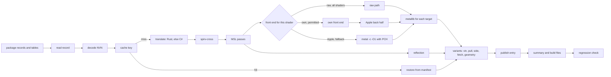

# Shader step

The shader step changes the GPU machine code of a game into Metal libraries. The command is `nxb shaders`. The code is in
`nxb-shader` (L1), the runtime crates (L2) and `nxb-stages` (L3).

## Rules

1. **Port rule.** A port gives the same files as the reference build scripts for the same inputs.
   This applies to orchestration, passes, reflection, variants, guards and the store.
2. The tests compare the last output files (`.metallib`, `.json`, `.metal`, tables), not `.air` files.
   The `.air` bytes can differ when the libraries are byte-identical (measured on 300 of 300 libraries).
3. **Front-end rule.** The own front end changes bytes by design. It ships with a new chain version and a fallback to the Apple front end for each shader
   (refer to [frontend.md](frontend.md)). The own-identical tier has proof for each shader. **The raw tier has no proof for each shader since 0.4.0.**
   It is the one exception to the rule: it is on for all shaders, and only a part of the corpus has a GPU test (refer to the section on the raw tier).
4. A port and a front-end change are not in the same pull request.

## Interfaces

| interface | contract |
|---|---|
| input from the split | package files `<stage>_<group>.bin` (`BTCDBTCD` records) and the tables `shader_map.tsv`, `shader_facts.tsv`, `shader_pairs.tsv`, `pso_pairs.tsv` |
| translator | the `Translator` trait in `nxb-tool`. One call translates a batch of tasks. Each task has the job JSON of the reference build scripts. The implementations are the Rust translator (off by default), the translator host and the process bridge (see the section on the translator choice) |
| output of the translator | `<key>.spv` and `<key>.res.json`. The Rust translator also writes `<key>.iface.json` (the `ShaderInterface`) |
| output to the pack stage | `b-<V>/` folders, `inputs.tsv`, `_b_build.json`, `_b_cas.txt`, `c1_full.tsv`, `cb_extent.tsv`, the reuse keys |
| output to the archive stage | `pso_pairs.tsv` and the reflection fields `entry`, `entry_z`, `pull`, `vertex_inputs`, `raster.primitive_id`, `bindings` |
| progress | NDJSON events |

## Task graph

The reference build scripts do the cache checks in series, then all translations, then two thread-pool passes.
The shader step streams: each shader goes to the next task when its inputs are ready. The only real dependencies are the
vertex shaders that wait for their pixel shaders (`vs_pad`) and the summary at the end.

## Translator choice

The step has three ways to translate one key. **Since 0.5.1, the first way is off by default.** The step tries the ways in this sequence for each key:

1. **The Rust translator** (`nxb-xlate`, `nxb-maxwell` and `nxb-spvgen`). It runs in the process. It is off by default.
   `--xlate-rust on` (for `nxb shaders build`) or `NXB_XLATE_RUST=1` (also for `nxb build`, which has no option for it) turns it on. The values `1`, `on` and `true` turn it on. Each other value leaves it off.
   The cause is that the Rust translator does not follow the translator of the current engine. For example, it has no Maxwell denormal flush that the current engine translator has.
   On the current engine, its output can thus differ from the output of the C# translator. Earlier documents (0.4.0 and 0.5.0) said that it is on by default. That was incorrect for the current engine.
   When it is on, a key that it cannot do returns an error that starts with `unported:`. A panic is caught. In both cases, the key goes to the next way. The step counts each reason (`rust unported`, `rust error`, `rust panic`).
2. **The translator host.** One process loads the C# translator and does the work of many batches. It is the default when the program `dmsh_xlate_host` is next to `dmsh_xlate`.
   `--xlate-host "PROGRAM [ARGS]"` or `NXB_XLATE_HOST` selects it, and `--xlate-host off` or `NXB_XLATE_HOST=off` turns it off. The host has a watchdog of 60 s plus 10 s for each key.
   A host that fails or hangs is killed and started again. After more than 6 restarts, a failed start or no answer to a ping in 10 s, the step stops to use the host. The counters for starts, restarts and fallbacks are in the run report.
3. **The process bridge.** One C# process for each batch, as the reference build scripts do. It divides a bad batch until each bad key is alone.

The two C# ways (the host and the process bridge) give the same bytes. The Rust translator gave the same bytes only on the engine version that it was ported from (table below).
Nobody compared it again with the current engine. The translation cache identity does not name the translator. Thus a store can hold the output of both. Do not turn the Rust translator on for a store that must stay equal to the C# output.
A key without a way that works is `translation failed`.

When the Rust translator is on, it does not do these parts (the key goes to the C# translator):

- Geometry, tessellation, transform feedback and vertex shaders as compute. No local title has these (only one geometry shader exists in the corpus), thus nobody ported them without a corpus.
- The function match for the fragment interlock.
- The helper functions for the shared store of small integers with a compare and swap (`SharedStoreSmallIntCas`).
- Some Ampere encodings.
- Task and mesh shaders. The job writer refuses them.

Evidence for the Rust translator (measured, SPIR-V and `res.json` compared byte for byte with the C# translator, first-attempt jobs only). These results are for the engine version of the port, not for the current engine:

| corpus | keys | identical |
|---|---|---|
| reference title (Maxwell) | 16,268 | 16,268 |
| second title (Maxwell) | 19,592 | 19,592 |
| third title (Maxwell) | 28,669 | 28,669 |
| Switch 2 title (Ampere) | 42,331 | 42,299. The 17 compute keys that fail in the C# translator also, and 15 keys with `SharedStoreSmallIntCas` go to the C# path |

An earlier test with 802 jobs gave 802 of 802 identical with the host and with the process bridge.
The rates count first-attempt jobs. Jobs that the C# translator tries again with another option (guessed image types, a geometry reader) are not in the rates. The retry with 64-bit float helpers is in the rates.
The Ampere path is checked on one title.

Time (measured, a subset of 160 keys or 261 shaders, load average about 10, own front end off): 16 s with the process bridge, 17 s with the Rust translator, and 20.2 s with the host against 20.7 s without it.
There is no gain in this subset, because the Metal compile dominates. The translator part alone is faster: 802 jobs took 1.0 to 1.7 s with the host against 6.3 to 8.4 s with 19 process starts.
In a full cold build, the number of .NET starts changes from 667 to about 1. That is an **estimate**. Nobody measured a full build with the host or with the Rust translator.
Before the Rust translator can be the default again, the changes of the engine translator must be ported (refer to the known limits in the README).

## Shader interface

For each key, the Rust translator writes `<key>.iface.json` next to `<key>.res.json`. It is the typed `ShaderInterface` (version 1) of the shader. It has these parts:

- the bindings (constant buffers, storage buffers with their address words, textures and images, and the source of each handle),
- the handle words that the host must fill,
- the fragment outputs for each target (component masks and the type of the job),
- the integer vertex inputs and `frag_coord`,
- the flags for render scale,
- the local size and the shared memory of a compute shader,
- the geometry stride and the fetch of 1D textures.

`dual_source_candidate` is true when targets 0 and 1 are written. Only the blend state decides if the shader is a dual-source shader. The interface works for each translator that writes a `res.json`.
Tests: derived facts, a round trip of the schema, a refusal of a different version and a round trip of 802 `res.json` files. The host does not read the file yet.

## Versions and keys

| identity | function | made from |
|---|---|---|
| V (chain version) | names the folder `b-<V>/` that the host loads. Each `_b.json` file has the same value | the files in `chain-files.txt`, the translator options, `OUTPUT_VERSION` |
| DOMAIN_FP | cache validity of each shader | the same file set, hashed for each module |
| TOOL_FP | the external tools that made a result | translator identity, `spirv-cross` version, `metal` identity, SDK version, deployment target, PCH convention, front-end id |
| BIN_ID | the `nxb` binary that ran | SHA-256 of the binary, rustc version, `Cargo.lock` digest, commit, flags |

The rules for these identities:

1. V and DOMAIN_FP come from source files, not from the binary. `chain-files.txt` names the sources of the crates in V,
   the versions of their dependencies, the front-end verdict data and `OUTPUT_VERSION`.
2. `OUTPUT_VERSION` is an integer. Increase it by hand for an output change that no hashed file shows.
3. The runtime crates are not in V, and TOOL_FP does not contain BIN_ID. A new binary from the same sources keeps V and all cache keys.
4. The design compares BIN_ID with a lock file at start, and a mismatch is a `[RED]` build error. The code does not have this check at this time. The command `nxb self-check` only finds the external tools and shows their versions.
5. The reuse key of the build contains BIN_ID. After a runtime fix, the shader step runs one more time, with cache hits only.
6. The first release of the own front end changes V. The Metal cache format changes from `dmsh_mtlcache 2` to `3`,
   and its identity gets the front-end id. Apple libraries and own libraries thus do not share a cache entry.
7. Since 0.5.1, the value of V in each `_b.json` file is the computed V. In 0.5.0, the vertex shader files had the constant `0ad559cdbb28`.
   The folder name had the computed V. The two values were not equal. In a full Wonder run with the 0.5.0 code, the pipeline archive found no base library. The build packed the app without an archive.
   The calculation of V reads the engine files that `dmsh_chain.py` names.

## Execution model

- **CPU.** Tokens = logical cores plus 2 (default). A thread task or a child process holds one token. The target is a use
  of 90 % or more of the PCE until the last 5 % of the tasks. The QoS class is `USER_INITIATED`.
- **Priorities.** The critical path is first: pixel shaders that vertex shaders wait for, and mesh pair parts.
  Then the longest task is first. Its cost comes from the time of the previous build, or from the MSL size.
  The translator gets small batches (default 32 keys), so that compiles start after some seconds.
- **Memory.** The budget is the smaller value of `--mem-budget` and (0.5 x memory size minus 2 GiB). For 32 GB, this is 14 GiB.
  Each task has an expected peak memory from the previous build. The defaults are estimates: 300 MB for `metal -c` of a
  large pixel unit, 150 MB for other compiles, 400 MB for a translator process. A task starts only when tokens and memory are free.
- **Single-flight.** The compile-input digest prevents two compiles of one input in the process. A lock file in the store does the same across processes.

## External tools

Each child process starts with an empty environment and gets only the variables below. `xcrun` finds each tool path and
each SDK path one time for each target. The step then calls the tools directly. This saves approximately 6 ms for each call (measured on one sample).

| tool | variables |
|---|---|
| `metal`, `metallib` | `SDKROOT` (from `xcrun -sdk macosx` or `-sdk iphoneos --show-sdk-path`), `PATH`, `TMPDIR`, `HOME` |
| C# translator (host or process bridge) | `DOTNET_ROOT` (if set), `HOME`, `TMPDIR`, `PATH`, `DOTNET_CLI_TELEMETRY_OPTOUT=1`, `XLATE_DEBUG`, `XLATE_REDUCED`. The Rust translator needs none of these |
| `spirv-cross` | `PATH`, `TMPDIR` |

The step does not pass `DEVELOPER_DIR`, `TOOLCHAINS`, `MTL_*`, `METAL_*`, `CLANG_*`, `CCC_*`, `LLVM_*`, `CPATH`,
`C_INCLUDE_PATH` or the deployment-target variables. Without `SDKROOT`, a direct call of `metal` writes different bytes (measured).

Compile conventions:

- Mac: `-c -O1 -fpreserve-invariance`.
- iOS: `-c -O1 -mios-version-min=18.0 -fmetal-math-mode=relaxed -fpreserve-invariance`.
- The source goes to stdin. There is one PCH for each convention and target.

**Recovery.** Each child is in its own process group. On SIGINT or SIGTERM, the step kills all groups (exit code 130).
A translator batch has a watchdog: 60 s plus 10 s for each key (estimate). After a crash or a hang of a batch, the step
keeps the completed results and divides the other keys into smaller batches until each bad key is alone. The cost is a
maximum of 2 x log2(batch) runs for each bad key. For the other tools, a crash or a timeout is a failure of one shader.

## Result store

- **Format 1** is the content-addressed store of this workspace. Each stage output has a key from the stage version and
  the content hash of its inputs. No key contains V (refer to [early-cutoff.md](early-cutoff.md)).
- **Manifest.** The store writes the manifest of an entry last. A restore reads it one time, examines all sizes, and
  examines SHA-256 for 1 % of the files. After an unclean stop, it examines all digests.
- **Quarantine.** An entry with a bad check goes to `quarantine/`. The store does not delete it. The step compiles that shader again.
- **Durability.** Temporary name, `fsync`, rename, manifest last, `fsync` of the folder. A dirty marker with a journal of digests in progress replaces `F_FULLFSYNC`.
- **Locks.** An exclusive `flock` on `b-<V>/.shaderbuild.lock` for each build. A shared lock on the store root for builds, and an exclusive lock for prune and migration.
- **Target keys.** Each key contains the SDK, the deployment target, the compiler target version, the compile convention and the front-end id.

## Raw container tier

The raw tier (`own-raw`) is the first tier of the own front end in `build` and `recompile`. It is for the Mac target only.
For a shader, the step calls `air_front::build_raw` in the same process. This call does the front end,
the split of the entries, the optimizer, the bitcode writer and the library writer. It uses no Apple tool and starts no process.

**Since 0.4.0, the tier is on for each shader that the own front end accepts.** In 0.3.0, it was on only for shaders on an allow list.
The new default has a check in the process, but no GPU test for each shader.

- **Check in the process.** The library must parse as a metallib and write back to the same bytes. Each function must have a name and a bitcode wrapper with the magic `BC C0DE`.
  A reject by the front end, an internal error, a panic or a failed check sends the shader to the next tier. The next tiers are the own `own-identical`
  path and then Apple's `metal -c` with `metallib`.
- **What the check does not do.** It does not run the shader. A library can load in Metal and still give a different output than Apple's library.
- **Evidence.** An earlier GPU test used 12 test vectors for each shader. It covered 3,625 of the 23,752 candidates (about 15 %).
  3,375 gave the same output as Apple's library, 220 gave a different output, 29 were not deterministic and 1 was not built.
  So 220 of 3,625 (about 6 %) differed in that sample. The other shaders were not tested. The sample was not random, thus 6 % is not an estimate for the whole corpus.
  A smoke test of the harness on 8 shaders gave 7 equal and 1 different (the largest error was 166 ulp).
  The old allow list (3,365 entries, about 14 % of the corpus) has the shaders that matched in the test. It is not in this repository.
- **Switches.** `NXB_OWN_RAW=0` turns only the raw tier off. `NXB_OWN_RAW=list` uses only the shaders of the shipped allow list (old behavior).
  The tier is off when the file is missing. `NXB_OWN_RAW=<file>` uses another list. `NXB_OWN_FRONT=0` or `--own-front off` turns all own tiers off. The tier needs the own front end to be on.
  The run note of the step tells which mode is on and how many libraries came from the raw tier and from Apple.
- **Cache key.** A raw library has the key field `own-raw@` and the front-end id, for each shader. A raw library is thus never given to a run with the tier off.
  Entries that an older version made in the list mode are not used.
- **Output.** A raw library is not byte-identical to Apple's library, and it is larger (1.33 times on 40 samples, measured). This is by design.
  A change of the optimizer does not change `air_front::id()`. Thus change the id when you ship a front-end change.

Measured (subset of 160 keys, 261 shaders, cold store, load average 8 to 12, `nxb shaders build`): 363 library compiles gave 363 raw libraries, with no fallback, and Apple made 0.
All 699 output libraries load in Metal (1,092 functions, 0 failures). The wall time was 6.5 s with the tier and 14.4 s without it. This is not a benchmark.
A smaller measurement (40 shaders, 44 raw libraries, loaded machine) gave a median compile CPU time of 97.5 ms against 109 ms without the tier (about 11 % less).
Nobody measured a full cold build with the tier on all shaders. The estimate of 4 to 6 minutes less is **not measured**.

## Errors

| class | scope | examples | effect |
|---|---|---|---|
| `ShaderError` | one shader | a pass rejects input, `metal` error, translator failure | the reason string of the reference build scripts. The build continues. |
| `ToolError` | one task | crash, timeout, exit code not 0 | recovery, then `ShaderError` |
| `FrontEndReject` | one shader | construct not covered, back-half failure | fallback to the Apple front end, counted |
| `BuildError` | the build | lock mismatch, missing facts table, bad `DMSH_TARGETS` | `[RED]` text, exit code 1 |
| `EnvError` | the machine | `ENOSPC`, `EDQUOT`, `EMFILE`, `ENFILE`, `EIO`, `EROFS`, missing toolchain | abort |
| `Internal` | one task | a panic that `catch_unwind` catches | `internal error` for the shader, a `[RED]` note |

**Abort.** On `EnvError` or `BuildError`, the step kills all process groups. It does not write the stamp, the reuse key
or `_b_cas.txt`. It keeps the completed store entries, writes the `[RED]` lines and an `error` event, and stops with exit code 1.

**Circuit breaker.** Eight failures in sequence with the same tool, exit kind and first stderr line become an `EnvError`.
Failures in more than 50 % of the first 200 tasks of a tool also become an `EnvError`.
`ENOSPC`, `EDQUOT`, `EROFS` and `EIO` stop the build at the first occurrence. `EMFILE` and `ENFILE` stop it after 3 occurrences.

## Determinism

- The output order does not come from the completion order or from a hash map. `_b_build.json` and the summary use the key
  order of the reference build scripts. JSON goes through `nxb-pyjson` (insertion order, `indent=1`, Python float format).
- The tests compare 1 task against N tasks, two runs, and pipes against files. Apple's tools gave the same bytes on 300 of 300 samples (measured).
- **Drift samples.** On a cache hit, the step compiles 0.5 % of the shaders again and compares the bytes. A mismatch gives a
  `[RED]` note, puts the entry in quarantine and publishes the new bytes. The cost is approximately 0.5 % of the compile time (derived).

## Progress and fixed strings

- `--events <path|fd>` writes NDJSON events: `phase`, `progress` (`step`, `done`, `total`, `unit`), `shader`, `error`, `summary`.
  The format is compatible with the nxnative event stream.
- Callers parse some strings. Thus these strings must not change: `shaders {N}: ok {K}, ...`, `shader cache: hit {H}, rebuilt {M}`,
  `shader regressions against b-XXXX: N`, all `[RED] ` lines, and the failure-classifier keys. `tests/contract_strings.rs` compares them.

## Parity results

The results are for the reference title and the Mac target (measured).

| part | compared on | result |
|---|---|---|
| JSON writer | 16,269 JSON files | all byte-identical |
| `_b` and `_bx` libraries | 16,268 shaders | 16,268 `_b` and 11,315 `_bx` byte-identical |
| variants `_bp`, `_bv`, `_bf` | all vertex and pixel shaders | 4,763 `_bp`, 529 `_bv`, 9,008 `_bf` byte-identical |
| guard tables | 16,268 shaders | byte-identical |
| translator bridge | 652 shaders | 652 `.spv` and `res.json` byte-identical |
| `spirv-cross` and MSL passes | 649 pixel and 3 compute shaders | all `_b.metal` and `_b.json` byte-identical |
| full step | one full run | 74,421 of 74,422 files byte-identical. The step does not write `_b_cas.txt` at this time. |
| libraries and `_b.json`, current engine, C# translator, own front end off | a full run against a Python build of the same current engine. A sample of 41,883 libraries | 0 of 41,883 differ. 5 shaders are stubs that the Python run itself left (a 0-byte `.metal` and a 96-byte library). The raw tier and the own-identical tier were not part of this run |
| Rust translator | 16,268 keys of this title, engine version of the port | all `.spv` and `res.json` byte-identical to the C# translator. Not repeated on the current engine |

These parts are not ported at this time: geometry and mesh shaders (the reference title has none), some guards that do
not fire on the reference title, the full iOS target (a sample of 787 shaders was compared), `_b_cas.txt`, and the calculation of V from Rust sources.
These parity results use the Apple front end or the own-identical tier. They do not cover the raw tier, which is not byte-identical.
