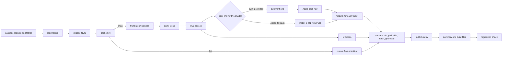

# Shader step

The shader step changes the GPU machine code of a game into Metal libraries. The binary is `shaderbuild`. The code is in
`nxb-shader` (L1), the runtime crates (L2) and `nxb-stages` (L3).

## Rules

1. **Port rule.** A port gives the same files as the reference build scripts for the same inputs.
   This applies to orchestration, passes, reflection, variants, guards and the store.
2. The tests compare the last output files (`.metallib`, `.json`, `.metal`, tables), not `.air` files.
   The `.air` bytes can differ when the libraries are byte-identical (measured on 300 of 300 libraries).
3. **Front-end rule.** The own front end changes bytes by design. It ships only with a new chain version, evidence for each
   shader and a fallback to the Apple front end for each shader (refer to [frontend.md](frontend.md)).
4. A port and a front-end change are not in the same pull request.

## Interfaces

| interface | contract |
|---|---|
| input from the split | package files `<stage>_<group>.bin` (`BTCDBTCD` records) and the tables `shader_map.tsv`, `shader_facts.tsv`, `shader_pairs.tsv`, `pso_pairs.tsv` |
| translator | the `Translator` trait in `nxb-tool`. One call translates a batch of tasks. Each task has the job JSON of the reference build scripts. |
| output to the pack stage | `b-<V>/` folders, `inputs.tsv`, `_b_build.json`, `_b_cas.txt`, `c1_full.tsv`, `cb_extent.tsv`, the reuse keys |
| output to the archive stage | `pso_pairs.tsv` and the reflection fields `entry`, `entry_z`, `pull`, `vertex_inputs`, `raster.primitive_id`, `bindings` |
| progress | NDJSON events |

## Task graph

The reference build scripts do the cache checks in series, then all translations, then two thread-pool passes.
The shader step streams: each shader goes to the next task when its inputs are ready. The only real dependencies are the
vertex shaders that wait for their pixel shaders (`vs_pad`) and the summary at the end.

## Versions and keys

| identity | function | made from |
|---|---|---|
| V (chain version) | names the folder `b-<V>/` that the host loads | the files in `chain-files.txt`, the translator options, `OUTPUT_VERSION` |
| DOMAIN_FP | cache validity of each shader | the same file set, hashed for each module |
| TOOL_FP | the external tools that made a result | translator identity, `spirv-cross` version, `metal` identity, SDK version, deployment target, PCH convention, front-end id |
| BIN_ID | the `shaderbuild` binary that ran | SHA-256 of the binary, rustc version, `Cargo.lock` digest, commit, flags |

The rules for these identities:

1. V and DOMAIN_FP come from source files, not from the binary. `chain-files.txt` names the sources of the crates in V,
   the versions of their dependencies, the front-end verdict data and `OUTPUT_VERSION`.
2. `OUTPUT_VERSION` is an integer. Increase it by hand for an output change that no hashed file shows.
3. The runtime crates are not in V, and TOOL_FP does not contain BIN_ID. A new binary from the same sources keeps V and all cache keys.
4. `shaderbuild self-check` compares BIN_ID with `shaderbuild.lock` at start. A mismatch is a `[RED]` build error.
5. The reuse key of the build contains BIN_ID. After a runtime fix, the shader step runs one more time, with cache hits only.
6. The first release of the own front end changes V. The Metal cache format changes from `dmsh_mtlcache 2` to `3`,
   and its identity gets the front-end id. Apple libraries and own libraries thus do not share a cache entry.

## Execution model

- **CPU.** Tokens = logical cores plus 2 (default). A thread task or a child process holds one token. The target is a use
  of 90 % or more of the PCE until the last 5 % of the tasks. The QoS class is `USER_INITIATED`.
- **Priorities.** The critical path is first: pixel shaders that vertex shaders wait for, and mesh pair parts.
  Then the longest task is first. Its cost comes from the time of the previous build, or from the MSL size.
  The translator gets small batches (default 32 keys), so that compiles start after some seconds.
- **Memory.** The budget is the smaller value of `--mem-budget` and (0.5 x memory size minus 2 GiB). For 32 GB, this is 14 GiB.
  Each task has an expected peak memory from the previous build. The defaults are estimates: 300 MB for `metal -c` of a
  large pixel unit, 150 MB for other compiles, 400 MB for a translator process. A task starts only when tokens and memory are free.
- **Single-flight.** The compile-input digest prevents two compiles of one input in the process. A lock file in the store does the same across processes.

## External tools

Each child process starts with an empty environment and gets only the variables below. `xcrun` finds each tool path and
each SDK path one time for each target. The step then calls the tools directly. This saves approximately 6 ms for each call (measured on one sample).

| tool | variables |
|---|---|
| `metal`, `metallib` | `SDKROOT` (from `xcrun -sdk macosx` or `-sdk iphoneos --show-sdk-path`), `PATH`, `TMPDIR`, `HOME` |
| translator | `DOTNET_ROOT` (if set), `HOME`, `TMPDIR`, `PATH`, `DOTNET_CLI_TELEMETRY_OPTOUT=1`, `XLATE_DEBUG`, `XLATE_REDUCED` |
| `spirv-cross` | `PATH`, `TMPDIR` |

The step does not pass `DEVELOPER_DIR`, `TOOLCHAINS`, `MTL_*`, `METAL_*`, `CLANG_*`, `CCC_*`, `LLVM_*`, `CPATH`,
`C_INCLUDE_PATH` or the deployment-target variables. Without `SDKROOT`, a direct call of `metal` writes different bytes (measured).

Compile conventions:

- Mac: `-c -O1 -fpreserve-invariance`.
- iOS: `-c -O1 -mios-version-min=18.0 -fmetal-math-mode=relaxed -fpreserve-invariance`.
- The source goes to stdin. There is one PCH for each convention and target.

**Recovery.** Each child is in its own process group. On SIGINT or SIGTERM, the step kills all groups (exit code 130).
A translator batch has a watchdog: 60 s plus 10 s for each key (estimate). After a crash or a hang of a batch, the step
keeps the completed results and divides the other keys into smaller batches until each bad key is alone. The cost is a
maximum of 2 x log2(batch) runs for each bad key. For the other tools, a crash or a timeout is a failure of one shader.

## Result store

- **Format 1** is the content-addressed store of this workspace. Each stage output has a key from the stage version and
  the content hash of its inputs. No key contains V (refer to [early-cutoff.md](early-cutoff.md)).
- **Manifest.** The store writes the manifest of an entry last. A restore reads it one time, examines all sizes, and
  examines SHA-256 for 1 % of the files. After an unclean stop, it examines all digests.
- **Quarantine.** An entry with a bad check goes to `quarantine/`. The store does not delete it. The step compiles that shader again.
- **Durability.** Temporary name, `fsync`, rename, manifest last, `fsync` of the folder. A dirty marker with a journal of digests in progress replaces `F_FULLFSYNC`.
- **Locks.** An exclusive `flock` on `b-<V>/.shaderbuild.lock` for each build. A shared lock on the store root for builds, and an exclusive lock for prune and migration.
- **Target keys.** Each key contains the SDK, the deployment target, the compiler target version, the compile convention and the front-end id.

## Errors

| class | scope | examples | effect |
|---|---|---|---|
| `ShaderError` | one shader | a pass rejects input, `metal` error, translator failure | the reason string of the reference build scripts. The build continues. |
| `ToolError` | one task | crash, timeout, exit code not 0 | recovery, then `ShaderError` |
| `FrontEndReject` | one shader | construct not covered, back-half failure | fallback to the Apple front end, counted |
| `BuildError` | the build | lock mismatch, missing facts table, bad `DMSH_TARGETS` | `[RED]` text, exit code 1 |
| `EnvError` | the machine | `ENOSPC`, `EDQUOT`, `EMFILE`, `ENFILE`, `EIO`, `EROFS`, missing toolchain | abort |
| `Internal` | one task | a panic that `catch_unwind` catches | `internal error` for the shader, a `[RED]` note |

**Abort.** On `EnvError` or `BuildError`, the step kills all process groups. It does not write the stamp, the reuse key
or `_b_cas.txt`. It keeps the completed store entries, writes the `[RED]` lines and an `error` event, and stops with exit code 1.

**Circuit breaker.** Eight failures in sequence with the same tool, exit kind and first stderr line become an `EnvError`.
Failures in more than 50 % of the first 200 tasks of a tool also become an `EnvError`.
`ENOSPC`, `EDQUOT`, `EROFS` and `EIO` stop the build at the first occurrence. `EMFILE` and `ENFILE` stop it after 3 occurrences.

## Determinism

- The output order does not come from the completion order or from a hash map. `_b_build.json` and the summary use the key
  order of the reference build scripts. JSON goes through `nxb-pyjson` (insertion order, `indent=1`, Python float format).
- The tests compare 1 task against N tasks, two runs, and pipes against files. Apple's tools gave the same bytes on 300 of 300 samples (measured).
- **Drift samples.** On a cache hit, the step compiles 0.5 % of the shaders again and compares the bytes. A mismatch gives a
  `[RED]` note, puts the entry in quarantine and publishes the new bytes. The cost is approximately 0.5 % of the compile time (derived).

## Progress and fixed strings

- `--events <path|fd>` writes NDJSON events: `phase`, `progress` (`step`, `done`, `total`, `unit`), `shader`, `error`, `summary`.
  The format is compatible with the nxnative event stream.
- Callers parse some strings. Thus these strings must not change: `shaders {N}: ok {K}, ...`, `shader cache: hit {H}, rebuilt {M}`,
  `shader regressions against b-XXXX: N`, all `[RED] ` lines, and the failure-classifier keys. `tests/contract_strings.rs` compares them.

## Parity results

The results are for the reference title and the Mac target (measured).

| part | compared on | result |
|---|---|---|
| JSON writer | 16,269 JSON files | all byte-identical |
| `_b` and `_bx` libraries | 16,268 shaders | 16,268 `_b` and 11,315 `_bx` byte-identical |
| variants `_bp`, `_bv`, `_bf` | all vertex and pixel shaders | 4,763 `_bp`, 529 `_bv`, 9,008 `_bf` byte-identical |
| guard tables | 16,268 shaders | byte-identical |
| translator bridge | 652 shaders | 652 `.spv` and `res.json` byte-identical |
| `spirv-cross` and MSL passes | 649 pixel and 3 compute shaders | all `_b.metal` and `_b.json` byte-identical |
| full step | one full run | 74,421 of 74,422 files byte-identical. The step does not write `_b_cas.txt` at this time. |

These parts are not ported at this time: geometry and mesh shaders (the reference title has none), some guards that do
not fire on the reference title, the iOS target, `_b_cas.txt`, and the calculation of V from Rust sources.
